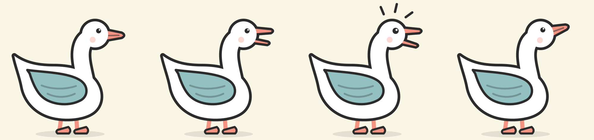

# Gans — Lexi's goose

**Why a goose.** German calls quotation marks *Gänsefüßchen*, "little goose feet". Every
line of dialogue written in German sits between her footprints, „like this“. And *goose*
and *Gans* are one word that has lived in two mouths: English lost the *n* before *s*, as
it did in *tooth · Zahn*, *mouth · Mund* and *five · fünf*. So the mascot is herself a
cognate pair, which is the theme of the page she lives on: *language is always in
dialogue with itself*.

She is a dictionary entry, not a card. *Gans* is one of the 93,000+ headwords Lexi
answers, not one of the words it teaches, and the about page draws her and her family
(*Gänsefüßchen*, *Gänsehaut*, *Gänseblümchen*, *Ganter*) in entry chrome. The two layers
never wear the same clothes (VISION, *Two layers*), and that holds for the mascot too.

## How she is built

One source, [`scripts/pages/gans.ts`](../../scripts/pages/gans.ts). It is a pure function
that returns SVG, and `node scripts/pages/gans.ts --write` redraws every file in this
folder.

- **The card box's materials and nothing else.** The index card's white for her body,
  the charcoal ink (`#2b2b2b`) for her one outline, the teal tab (`#93c1c1`) for her
  wing, the coral tab (`#f39483`) for her beak and feet. There are no new colours.
- **One outline, like a sticker's.** Every shape is drawn twice, ink first and then
  fill, so a single line runs around the whole silhouette and never crosses inside it.
- **No gradient, no texture.** She has to read at 24 px.
- **Her feet are quotation marks.** `footprints()` draws „ (two coral commas on the
  baseline) and, with `closing`, “ (high on the line). They are the page's quotation
  marks and the trail she leaves between sections.
- **No ids in the markup.** Any number of geese can share a page.

| Pose | Use |
|---|---|
| `stand` | The default. The hero, and anywhere she is simply present. |
| `talk` | Beak open. With `talk: true` she carries both beaks and a script toggles `.talking`. |
| `alarm` | Eyes wide, three startle lines. Only beside a false friend: a word that looks English and isn't. |
| `tilt` | Head cocked. A question, an aside, a "what is this?". |

## What she never does

These carry over from the Dackel in [TRAILS.md](../../docs/TRAILS.md), which she replaces,
and from the panel's ruling that a mascot appears at milestones and nowhere else
([PANEL-2026-10-04.md](../../docs/PANEL-2026-10-04.md)).

- **She never guilt-trips** and never mourns a streak. No sad goose, no "she misses you".
- **She never grades**, and never treats scrolling as evidence. Pressing her honks; it
  writes nothing.
- **She never says more than a check proved.** Every German word in her mouth on the
  about page is checked against the shipped data when the page is built.
- **She never passes off an entry as a card.**
- **She never asks who you are.** No name, no account, no tracking.

## Where she lives

- **`/about`** ([`scripts/pages/about.ts`](../../scripts/pages/about.ts)), a static page
  written after the build. She honks when pressed (a sound synthesised in the browser,
  with no audio file), answers in German and then in English, and follows the pointer
  with her head.
- **`public/og-gans.jpg`**, the picture a link to `/about` unfurls as
  (`npm run og:gans`).
- **Inside the app, nowhere yet**, apart from a link in Profile. Where she may appear
  there is VISION open decision 3c, and the panel's answer stands until it is decided:
  at milestones, and nowhere else.
